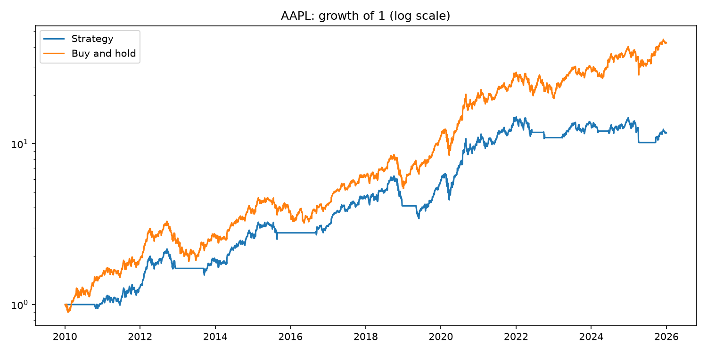

# SMA Crossover Backtester

A small backtester I wrote to test a moving average crossover strategy on
a single stock. Long when the fast SMA is above the slow SMA, otherwise
in cash.

## How it works

- Downloads daily prices with yfinance
- Computes a fast and slow simple moving average
- Goes long when fast > slow, sits in cash otherwise
- The signal is lagged by one day so we trade on tomorrow's open using
  yesterday's close signal (no look-ahead bias)
- Charges a transaction cost every time the position changes

## Setup

    pip install -r requirements.txt

## Usage

    python backtester.py AAPL

Or with custom settings:

    python backtester.py AAPL --start 2015-01-01 --end 2024-01-01 --fast 20 --slow 100 --cost 0.001

Arguments:

- `ticker` – stock symbol (required)
- `--start` – start date, default 2010-01-01
- `--end` – end date, default 2026-01-01
- `--fast` – fast SMA window, default 50
- `--slow` – slow SMA window, default 200
- `--cost` – cost per trade as a fraction, default 0.001 (0.1%)
- `--plot` – output file for the equity curve, default equity_curve.png

## Output

It prints a table comparing the strategy to buy and hold:

- total return
- CAGR
- volatility
- Sharpe ratio
- max drawdown

It also saves a plot of the equity curve on a log scale.

## Example

    AAPL 2010-01-01 to 2026-01-01, SMA 50/200, cost 0.10% per trade

    Strategy vs Buy and hold table here...

    Position changes: 12
    Days invested: 68.4%

## Notes

- This is just for learning, not investment advice.
- Only handles one stock at a time.
- Assumes you can always trade at the close and ignores slippage beyond
  the flat cost per trade.

## Files

- `backtester.py` – the whole thing
- `requirements.txt` – dependencies
- `equity_curve.png` – example output plot